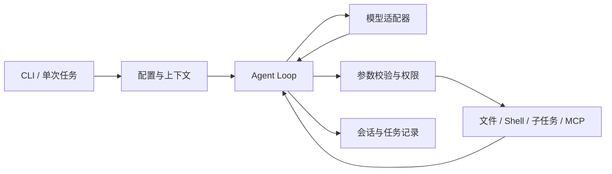

# Personal Agent

[](https://github.com/yuhangchen0812/personal-agent/actions/workflows/windows-ci.yml)
[](https://github.com/yuhangchen0812/personal-agent/actions/workflows/container-acceptance.yml)

一个基于 Python 的命令行 Agent，支持工具调用、权限审批、会话恢复、Skills、子任务委派和 stdio MCP。提供可复现的 CI 失败诊断与修复演示，保留从证据、候选差异到测试和回滚的完整链路。

> A Python CLI agent with tool permissions, resumable sessions, skills, MCP integration, and reproducible CI repair workflows.

**运行基线：Python 3.12 · Windows CLI · OpenAI-compatible / Anthropic Messages**

[快速开始](docs/QUICKSTART.md) · [系统架构](docs/ARCHITECTURE.md) · [使用指南](docs/USAGE.md) · [演示与测试](docs/TESTING.md) · [能力边界](docs/LIMITATIONS.md)

## 项目重点

- **可控执行**：工具参数校验、显式 allow/deny、五种权限模式、Plan 审批，以及有限次数的 Agent Loop。
- **任务可恢复**：具名 Session、工具调用 ID 配对、流式完整性检查、取消与请求重试；会话恢复不会重放旧工具。
- **上下文与方法管理**：长期记忆、结构化会话摘要、Skills 发现/检索/缓存，以及显式候选评估和采纳。
- **工具扩展**：内置文件/PowerShell 工具、自定义子 Agent、stdio MCP 连接与工具按需加载。
- **工程实战**：CI 失败报告导入、源码证据引用、候选差异审阅、公开测试与独立回归、版本绑定采纳和回滚。

## 快速开始

安装 Python 3.12，在项目根目录执行。无需激活虚拟环境：

```powershell
python -m venv .venv
.\.venv\Scripts\python.exe -m pip install -r requirements-dev.txt
.\demo.cmd doctor
.\demo.cmd
```

默认演示不需要 API Key：使用固定模型响应，实际执行文件工具和 Plan 流程，生成可查看的 HTML 报告。该报告展示执行机制，不代表实时模型能力评测。

连接真实模型时，将 `.env.example` 复制为 `.env` 并在本地填写密钥：

```powershell
Copy-Item .env.example .env
.\run.cmd --stream
```

CMD 复制文件使用 `copy .env.example .env`。环境变量优先于 `.env`；CLI 参数覆盖本次模型配置。真实任务会请求配置的模型服务。

## 一个有成功也有失败的完整演示

```powershell
.\.venv\Scripts\python.exe -X utf8 -B -m examples.ci_walkthrough
```

| 自编案例 | 候选公开测试 | 候选独立回归 | 流程结果 |
| --- | --- | --- | --- |
| 标签清洗 | 3 项通过 | 3 项通过 | 在演示副本采纳、测试，再回滚 |
| 分页候选 | 2 项通过 | 1 项通过、2 项失败 | 检出新增回归，拒绝生成采纳凭据 |

脚本使用固定响应驱动真实 Agent Loop 和 pytest。输出目录为 `.personal/ci-walkthrough/随机ID`；原始示例不改写。公开测试通过并不代表修复可以采纳，详细证据见本次运行的 `report.json` 和页面。

[查看发布版实跑的脱敏摘要](docs/DEMO.md)。

只观察 Agent Loop 的消息变化：

```powershell
.\.venv\Scripts\python.exe -X utf8 -B -m examples.agent_loop_walkthrough
```

## 执行链路



## 常用入口

| 目标 | Windows 命令 | 模型请求 |
| --- | --- | --- |
| 环境检查 | `.\demo.cmd doctor` | 无 |
| 文件与 Plan 演示 | `.\demo.cmd` | 无 |
| 交互式 Agent | `.\run.cmd --stream` | 有 |
| 单次 JSON 任务 | `.\run.cmd --prompt "解释 personal_agent/agent.py 的循环" --output-format json --dont-ask` | 有 |
| CI 任务帮助 | `.\task.cmd --help` | 无 |
| 可恢复修复任务帮助 | `.\task.cmd workflow --help` | 无 |

使用 Python 入口可替代 Windows 启动器：`python run_agent.py`、`python run_demo.py`、`python run_task.py`。PowerShell 工具依赖 Windows；Linux 文件型容器配置已提供，实际兼容范围见[能力边界](docs/LIMITATIONS.md)。

## 仓库结构

```text
personal_agent/       Agent 运行时、工具、协议和持久化
examples/             方法模板、自编任务、演示及测试工程
tests/                单元与集成测试
codex/                测试共用的验证辅助模块
docs/                 运行、架构、验证和范围说明
.github/              CI 与问题/PR 模板
playground/           文件工具的受控写入区域
```

## 验证与范围

本仓库区分固定模型流程验证、真实本地工具执行和真实模型调用；测试数据为自编示例，不宣称通用修复成功率或模型能力提升。CI 工作流不需要模型密钥。

本地运行 `.\verify.cmd` 即可执行 28 组默认离线验收，无需私人历史报告；只在显式添加 `--history` 时检查本机历史证据。

[测试方法](docs/TESTING.md) · [本次发布核验](docs/VALIDATION.md) · [权限与数据说明](SECURITY.md) · [参与开发](CONTRIBUTING.md)
