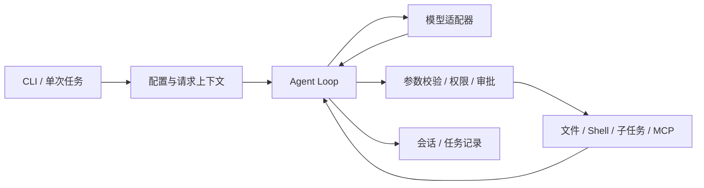

# Personal Agent

[](https://github.com/yuhangchen0812/personal-agent/actions/workflows/windows-ci.yml)
[](https://github.com/yuhangchen0812/personal-agent/actions/workflows/container-acceptance.yml)

一个面向本地开发任务的 Python 命令行 Agent，把模型请求、工具权限、会话恢复和 CI 修复流程连接起来。工具调用经过校验与审批，候选修改经过审阅与复验，执行结果保留可核对的记录。

> A Python CLI agent with controlled tools, resumable sessions, skills, stdio MCP, and reviewable CI repair workflows.

**Python 3.12 · Windows CLI · OpenAI-compatible / Anthropic Messages**

[快速开始](docs/QUICKSTART.md) · [使用指南](docs/USAGE.md) · [系统架构](docs/ARCHITECTURE.md) · [CI 流程演示](docs/DEMO.md) · [测试与验证](docs/TESTING.md) · [能力边界](docs/LIMITATIONS.md)

## 能做什么

| 场景 | 已有能力 |
| --- | --- |
| 本地任务 | 读取与检索文件、受控写入、PowerShell 命令，以及有限次数的 Agent Loop |
| 多轮工作 | 具名会话、流式输出、取消与请求重试；恢复后沿用历史，后续操作重新检查权限 |
| 上下文管理 | 长期记忆选择、结构化会话记忆、上下文压缩；参考信息注入请求副本 |
| 方法与扩展 | Skill 方法文档的发现、检索、评估与显式采纳；自定义子 Agent 和按需加载的 stdio MCP 工具 |
| CI 修复 | 导入本地失败报告与工程，冻结输入、调查源码、审阅候选、复验、采纳和回滚 |

## 快速开始

安装 Python 3.12，用 `python --version` 确认版本。在 PowerShell 中执行：

```powershell
git clone https://github.com/yuhangchen0812/personal-agent.git
cd personal-agent
python -m venv .venv
.\.venv\Scripts\python.exe -m pip install -r requirements.txt
.\demo.cmd doctor
.\demo.cmd
```

离线示例无需 API Key：它使用固定模型响应，实际执行文件工具、Plan 与审批流程，返回 HTML 页面和 JSON 报告的路径。输出保存在 `.personal/`，每次使用新目录。

### 连接真实模型

首次使用时创建本地配置，已有 `.env` 会保留：

```powershell
if (-not (Test-Path .env)) { Copy-Item .env.example .env }
```

按 [.env.example](.env.example) 填写本地凭据，再新建一个支持工具调用的流式会话：

```powershell
.\run.cmd --session first-task --with-tools --stream
```

例如输入“读取 personal_agent/agent.py，解释 run_agent_loop 的参数和返回值”。之后可恢复这个会话：

```powershell
.\run.cmd --resume first-task --stream
```

OpenAI-compatible 配置使用 `DASHSCOPE_API_KEY`；原生 Anthropic 使用 `ANTHROPIC_API_KEY` 与 `ANTHROPIC_MODEL`。协议、模型及端点可通过配置和 CLI 选择，详见[快速开始](docs/QUICKSTART.md)。单独的 `--stream` 是临时文本对话；需要工具时使用上面的具名工具会话，或直接运行 `.\run.cmd`。

## 一个包含回归拒绝的 CI 示例

在完整源码仓库安装开发依赖并运行：

```powershell
.\.venv\Scripts\python.exe -m pip install -r requirements-dev.txt
.\.venv\Scripts\python.exe -X utf8 -B -m tests.support.ci_walkthrough
```

| 自编案例 | 候选公开测试 / 独立回归 | 流程结果 |
| --- | --- | --- |
| 标签清洗 | 3 通过 / 3 通过 | 在工程副本中采纳、测试，再回滚并核对原始字节 |
| 分页候选 | 2 通过 / 1 通过、2 失败 | 发现新增回归，拒绝生成采纳凭据 |

示例使用固定响应驱动真实 Agent Loop、文件工具、pytest 和跨进程恢复，生成自己的报告页面。它展示执行与验证机制，不代表实时模型的修复成功率。步骤与结果解释见[CI 流程演示](docs/DEMO.md)。

## 执行链路



模型输出作为待执行请求或候选处理。工具入口决定能否执行；CI 复验决定能否生成采纳凭据。会话恢复不会重放旧工具，消息回退也不会撤销已发生的文件或进程副作用。

## 常用命令

| 目标 | Windows 命令 |
| --- | --- |
| 离线环境检查与演示 | `.\demo.cmd doctor`、`.\demo.cmd` |
| 临时工具对话 | `.\run.cmd` |
| 具名工具会话与流式输出 | `.\run.cmd --session first-task --with-tools --stream` |
| 单次 JSON 任务 | `.\run.cmd --prompt "读取 README.md 并概括项目结构" --output-format json --dont-ask` |
| MCP 示例 | `.\run.cmd --mcp-config examples/mcp-config.json --dont-ask` |
| CI 工作流帮助 | `.\task.cmd workflow --help` |

处理真实任务会请求所配置的模型服务；离线示例与帮助命令不请求模型。Windows 启动器也可替换为 `python run_agent.py`、`python run_demo.py` 和 `python run_task.py`。

## 源码与运行包

| 交付形式 | 内容与用途 |
| --- | --- |
| 源码仓库 | 应用、正式测试、测试数据、文档及 CI；用于运行、审阅和维护完整项目 |
| 运行包 | 应用、启动器、运行依赖清单与功能示例；不含应用自身的测试、仓库验证脚本或个人开发记录 |

需要精简运行包时，在源码仓库执行：

```powershell
.\demo.cmd pack --output-dir .personal/package
```

输出为 `personal-agent.zip` 与带 SHA256 的 `manifest.json`。运行包需要自行安装 Python 和依赖；源码中的完整 CI 流程复现需要 `requirements-dev.txt` 与 `tests/fixtures/`。

```text
personal_agent/       运行时、工具、模型适配与状态管理
examples/             Skill / Agent / MCP 模板及功能示例
tests/                正式回归测试
  fixtures/           自编工程和测试输入
  support/            共用集成检查与流程复现
scripts/              仓库验证入口
docs/                 安装、使用、架构与验证说明
.github/              自动检查与问题 / PR 模板
playground/           文件工具的受控工作目录
```

## 验证与范围

仓库维护完整回归与分组离线检查，CI 不需要模型密钥。新环境安装、真实本地工具执行和固定模型响应分别核验；具体命令与证据含义见[测试说明](docs/TESTING.md)。

主要验收环境为 Windows 与 Python 3.12。Linux 提供文件型容器配置，实际结果以对应提交的 CI 为准。原生 Anthropic 远端思考签名仍待实跑；权限规则是应用层约束。完整说明见[能力边界](docs/LIMITATIONS.md)与[权限及数据](SECURITY.md)。

## 许可证

当前未指定开源许可证。

[参与开发](CONTRIBUTING.md) · [维护者](https://github.com/yuhangchen0812)
