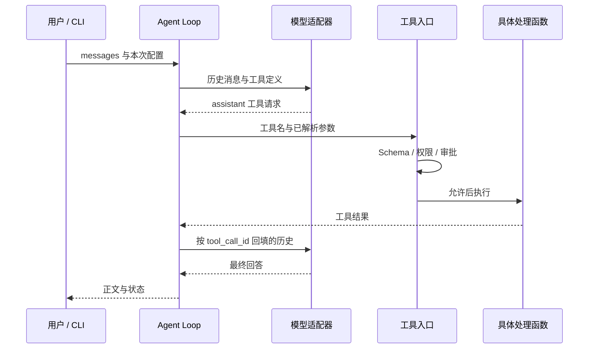

# 系统架构

## 运行时主线

`run_agent.py` / `python -m personal_agent` 进入 CLI，加载本次模型和权限配置，再将模型调用函数与工具执行函数交给 Agent Loop。

## 模块职责

| 模块 | 责任 |
| --- | --- |
| [cli.py](../personal_agent/cli.py) | 定义和校验启动参数，读取单次任务提示文件 |
| [main.py](../personal_agent/main.py)、[single_run.py](../personal_agent/single_run.py) | 交互式与单次任务入口、整轮错误处理、运行配置 |
| [repl_commands.py](../personal_agent/repl_commands.py) | Skill 管理、评估、反馈及 Agent/Skill 列表命令；使用主循环提供的上下文与模型回调 |
| [conversation.py](../personal_agent/conversation.py)、[project_memory.py](../personal_agent/project_memory.py) | 对话检查点、独立会话记忆、压缩，以及项目长期记忆的选择模式与索引缓存 |
| [execution.py](../personal_agent/execution.py) | 请求上下文和 MCP 工具暴露记录、模型用途路由、预算与用量衔接、轮次保存和失败收尾 |
| [agent.py](../personal_agent/agent.py) | 有界循环、调用 ID 配对、连续只读工具有限并发 |
| [llm.py](../personal_agent/llm.py)、[anthropic_adapter.py](../personal_agent/anthropic_adapter.py) | SDK 请求、协议适配、流式内容组装与完整性检查 |
| [tool_registry.py](../personal_agent/tool_registry.py)、[permissions.py](../personal_agent/permissions.py) | 工具说明、参数校验、权限决策、审批与实际执行边界 |
| [tools.py](../personal_agent/tools.py)、[plan.py](../personal_agent/plan.py) | 文件/Shell 工具、Plan 文件和状态 |
| [session.py](../personal_agent/session.py)、[memory.py](../personal_agent/memory.py)、[session_memory.py](../personal_agent/session_memory.py) | 对话保存、长期记忆、结构化接续记录 |
| [skills.py](../personal_agent/skills.py)、[skill_evolution.py](../personal_agent/skill_evolution.py)、[skill_eval.py](../personal_agent/skill_eval.py) | 方法加载、候选版本与独立回放评估 |
| [subagent.py](../personal_agent/subagent.py)、[mcp_runtime.py](../personal_agent/mcp_runtime.py) | 子任务权限继承与 stdio MCP 生命周期 |
| [repair_workflow.py](../personal_agent/repair_workflow.py)、[ci_repair.py](../personal_agent/ci_repair.py) | CI 阶段检查点、来源绑定复验、显式采纳与回滚 |

## 状态与副作用

Session 保存对话与引用；Memory 提供请求参考；CI task 保存阶段检查点；repair 事务保存候选和原始字节。它们服务于不同的恢复需求。

ConversationState 统一维护当前历史、轮次检查点和独立会话记忆引用；压缩或切换引用时，先保存会话，再更新运行中的状态。ProjectMemoryState 单独管理长期记忆的手动/自动选择和索引缓存。清空会话也先保存空历史，成功后再清理内存中的历史、记忆选择和自动压缩状态。

RequestContext 在每次父模型请求时组装参考上下文，记录实际暴露的 MCP 工具；执行入口据此检查模型是否已取得对应定义。ModelRequests 区分父循环、子任务、摘要和技能评估的请求范围，预算检查在请求前执行，用量在 finally 中累计。TurnLifecycle 统一保存、审批前检查点和失败消息回退；回退历史不撤销已执行工具的副作用。

恢复 Session 不会重放旧工具，也不会恢复旧授权。删除未完成消息不撤销文件或 Shell 副作用。源码恢复由明确的 repair rollback 完成，并检查当前文件版本，避免覆盖后续编辑。

## CI 应用链

失败 XML / 项目目录 → 冻结输入 → 只读调查与引用核验 → 候选差异 → 显式审阅 → 公开测试与独立回归 → 采纳凭据 → 显式 apply / rollback。

模型结论保持为待验证的假设。格式正确、循环完成、测试通过和允许采纳是分别检查的状态。
